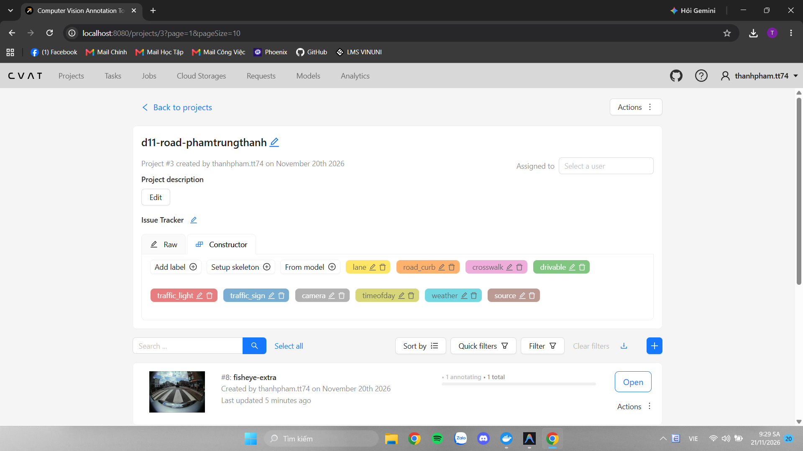
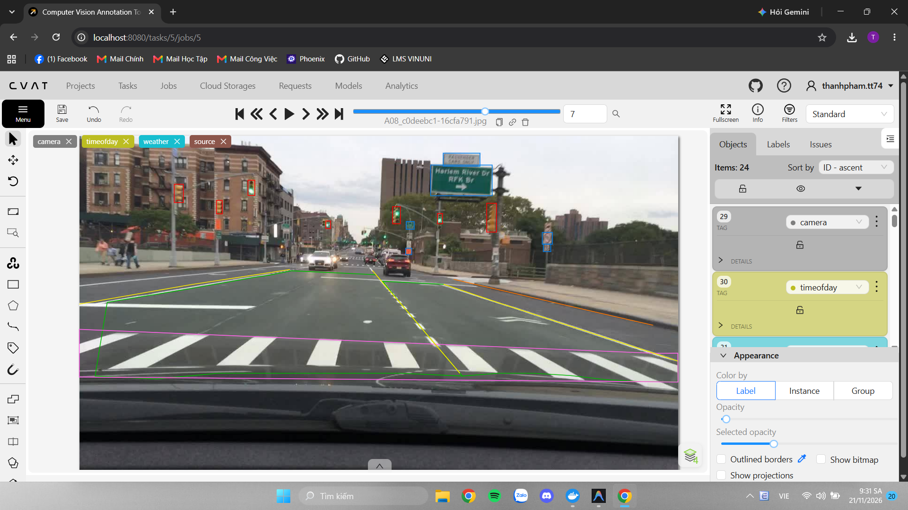
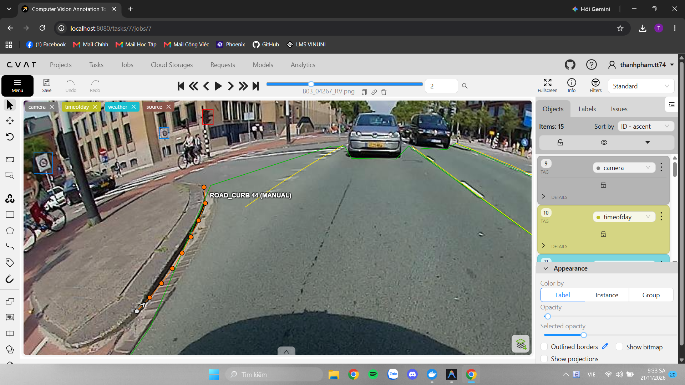

# Báo cáo cá nhân — Ngày 11
Họ tên: Phạm Trung Thành              Mã học viên: 2A202604050  
Phiên bản CVAT (Help → About): CVAT v2.74.1  
Guideline: Road v1.0    Lần nộp (`revision` trong manifest): 1  
Thời điểm export (ngày giờ trên CVAT): 2026-11-21 10:08 (UTC+7) / 2026-11-21T03:08:28Z    Số lần nộp lại sau Rework: 0  

## 1. Kiểm project
| Mục | Đúng như guideline Road v1.0? | Ghi chú |
| --- | --- | --- |
| 6 label, đúng kiểu | Đúng | `lane` (polyline), `road_curb` (polyline), `crosswalk` (polygon), `drivable` (polygon), `traffic_light` (rectangle), `traffic_sign` (rectangle) |
| Thuộc tính và giá trị | Đúng | Đã đối chiếu khớp 100% với `python -m road_lab.taxonomy` (gồm `position/style/color/kind`, `area_type`, `color/type/facing/edge_zone`, `group/facing/edge_zone`) |
| 4 tag ảnh | Đúng | `camera`, `timeofday`, `weather`, `source` (kiểu Tag, mỗi tag có 1 thuộc tính select tên `value`) |

Cách kết thúc polyline trên bản CVAT này: Bấm phím `N` (hoặc bấm nút `Done` / nhấp đúp chuột tại điểm cuối cùng).  
Cách đặt tag ảnh trên bản CVAT này: Chọn công cụ **Tag** (biểu tượng thẻ) ở thanh công cụ bên trái → chọn label tag (`camera`, `timeofday`, `weather`, `source`) → bấm **Shape** → mở mục **Details** của từng tag ở bảng **Objects** bên phải để chọn đúng giá trị `value`.  

## 2. Số lượng đã gán
| Task | Ảnh | lane | road_curb | crosswalk | drivable | traffic_light | traffic_sign |
| --- | ---: | ---: | ---: | ---: | ---: | ---: | ---: |
| front | 12 | 28 | 8 | 4 | 25 | 26 | 35 |
| front-extra (đã làm 4 / 4) | 4 | 11 | 0 | 2 | 7 | 11 | 19 |
| fisheye | 8 | 8 | 10 | 8 | 9 | 5 | 5 |
| fisheye-extra (đã làm 4 / 4) | 4 | 1 | 4 | 4 | 4 | 0 | 1 |
| **Tổng cộng** | **28** | **48** | **22** | **18** | **45** | **42** | **60** |

## 3. Bảng ca khó
| Ảnh | Nhãn | Phân vân giữa | Đã chọn | Lý do |
| --- | --- | --- | --- | --- |
| A02 | `lane`, `drivable` | Nắn vạch thẳng hay bám cong đoạn xa; có tính dải sỏi sát đường tàu bên phải vào `alternative` không | Vẽ polyline nhiều điểm bám cong đoạn xa (`L2, L1, R1`); không gán `drivable` lên dải sỏi | Đường rẽ cong trái rõ ở khoảng `y=400–450` (lệch >5 px nếu vẽ thẳng); bên phải `R1` là lề sỏi sát đường sắt, không phải làn xe chạy |
| A05, A06, A07, A09 | `lane` | Có vẽ vạch `L1` / `R1` giả dọc mép đường/hàng xe đỗ hay bỏ trống | Không gán `lane` ở phía không có vạch sơn (gán `road_curb` tại mép vỉa hè/rào bê tông) | Theo Guideline Road v1.0, chỉ gán `lane` khi có vệt sơn; phía không có sơn gán `road_curb` và chấp nhận 5 cảnh báo miễn trừ `QC1-02` từ `road_check lint` |
| A06 | `drivable` | Gộp chung cả 2 bên trụ cầu sắt thành 1 polygon `direct` hay tách riêng | Tách `direct` bên trái trụ cầu và `alternative` bên phải trụ cầu, không phủ qua chân trụ | Guideline mục 3 quy định vùng lái không bao gồm phần thân cọc/trụ và vùng phía sau cọc |
| A10, A15 | `traffic_sign` | Gộp cụm biển trên cùng một cột vào 1 box hay tách riêng từng tấm | Tách riêng từng tấm biển; tấm phụ nhỏ phía dưới biển chính gán `group=supplementary` | Guideline mục 3 yêu cầu biển phụ có hộp riêng với `group=supplementary`, mỗi tấm biển một box sát mép |
| B01, B02, B09 | `road_curb` vs `lane` | Hai mép chéo hai bên vạch ngựa vằn phố Amsterdam là `lane` hay `road_curb` | Gán `road_curb` (bỏ `lane`), đồng thời mở rộng `crosswalk` bao hết toàn bộ sọc trắng | Quan sát kỹ ảnh gốc không có vạch sơn kẻ làn mà là bó vỉa gạch đỏ/làn xe đạp tiếp giáp trực tiếp với mép sọc ngựa vằn |
| B11 | `lane` | Vạch sơn ô đỗ xe người khuyết tật có gán `lane` không | Không gán `lane`, chỉ gán `road_curb`, `drivable`, `traffic_sign` | Guideline mục 4 (Riêng ảnh fisheye) quy định rõ: "Vạch ô đỗ không gán lane" |

## 4. Phiếu QC 1 nhận được
Bạn kiểm lô của tôi: Đỗ Anh Hoàng (`DoAnhHoang`, file `DoAnhHoang-qc1-for-phamtrungthanh.md`)  Quyết định nhận được: **Hold** (0 lỗi định dạng/chính/nhẹ; chỉ nêu 5 cảnh báo `QC1-02` từ `road_check lint` chờ xác nhận ảnh gốc)  
| Mã lỗi | Số lỗi | Đồng ý? | Đã sửa? |
| --- | ---: | --- | --- |
| `QC1-02` (`A05` thiếu `L1`, `R1`) | 2 cảnh báo lint | Không tính lỗi (miễn trừ) | Giữ nguyên — ảnh đường nhỏ hai bên chỉ có xe đỗ và bó vỉa, thực tế không có vệt sơn kẻ làn (đã gán `road_curb` mép phải) |
| `QC1-02` (`A06` thiếu `R1`) | 1 cảnh báo lint | Không tính lỗi (miễn trừ) | Giữ nguyên — bên phải làn xe dưới gầm cầu là hàng trụ cầu sắt, không có vạch sơn `R1` |
| `QC1-02` (`A07` thiếu `L1`) | 1 cảnh báo lint | Không tính lỗi (miễn trừ) | Giữ nguyên — bên trái làn đang đi là dải phân cách bê tông sát lề, không có vạch sơn `L1` |
| `QC1-02` (`A09` thiếu `R1`) | 1 cảnh báo lint | Không tính lỗi (miễn trừ) | Giữ nguyên — bên phải mặt đường tiếp giáp trực tiếp bó vỉa hè, không có vạch sơn `R1` (đã gán `road_curb`) |
| `QC1-12` (lỗi file) | 0 | Đồng ý | Không cần sửa — cả 2 file zip mở lại tốt, `contains_images = false` |

## 5. Kiểm file export
| File | Mở lại được? | Số shape ảnh 1 (job / file) | Số shape ảnh 2 (job / file) | Tag camera có trong XML? |
| --- | --- | --- | --- | --- |
| `phamtrungthanh-front.zip` (16 ảnh: A01–A16, `contains_images: false`) | Có (`road_check lint` OK) | A01: 9 / 9 | A02: 7 / 7 | Có (`camera=front`, đủ 16/16 ảnh) |
| `phamtrungthanh-fisheye.zip` (12 ảnh: B01–B12, `contains_images: false`) | Có (`road_check lint` OK) | B01: 5 / 5 | B02: 6 / 6 | Có (`fisheye_front/rear/left/right`, đủ 12/12 ảnh) |

## 6. Ảnh chụp màn hình
1. Tab Labels của project:  
   
2. Một ảnh camera trước đã gán đủ (làn, vùng lái, đèn/biển):  
   
3. Một ảnh fisheye đã gán, phóng to đoạn polyline cong:  
   
4. Một đoạn XML có `<polyline label="lane">` (trích trực tiếp từ `annotations.xml` trong `phamtrungthanh-front.zip`, ảnh `A01`):
```xml
<polyline label="lane" source="file" occluded="0" points="0.00,603.10;45.00,587.70;95.70,570.30;146.40,553.00;197.10,535.70;247.70,518.30;298.40,501.00" z_order="3">
  <attribute name="position">L2</attribute>
  <attribute name="style">solid</attribute>
  <attribute name="color">white</attribute>
  <attribute name="kind">single</attribute>
</polyline>
```

## 7. Tự đánh giá
Lỗi bạn mắc nhiều nhất hôm nay (theo mã QC1-xx), và cách tránh ở Ngày 20:  
- Nhóm lỗi dễ mắc nhất khi kết hợp AI pre-label và rà soát thủ công là **`QC1-03` / `QC1-11`** (nhầm mép ngoài vạch ngựa vằn hoặc bó vỉa không sơn trên ảnh fisheye `B01, B02, B09` thành `lane`) và **`QC1-04`** (đường cong ở xa như `A02` bị nắn thành đoạn thẳng vượt ngưỡng lệch 5 px).
- Cách tránh ở Ngày 20: luôn xem ảnh gốc không bật lớp phủ (tắt tạm opacity) trước khi chốt nhãn để phân biệt rõ vệt sơn thật với bó vỉa/vạch ngựa vằn, thêm dày điểm neo tại khúc cua và vòng ngoài ảnh fisheye, rồi tự chạy `road_check lint` trước khi nộp.

Nhãn của bạn đi vào model ở đâu? Chọn một lỗi đã sửa và nói nó làm model học sai thế nào:  
- Bộ nhãn Road v1.0 là dữ liệu ground-truth huấn luyện và đánh giá các bài toán nhận thức môi trường xe tự hành: phát hiện làn đường (lane detection / LKA), phân đoạn vùng lái được (drivable area segmentation) và phát hiện đèn/biển báo giao thông.
- Ví dụ lỗi đã sửa ở **`B01, B02, B09`** (gán nhầm mép bó vỉa sát vạch ngựa vằn thành `lane` `L1/R1`) và **`A02`** (vẽ thẳng làm lệch khúc cua xa): nếu không sửa, model phát hiện làn sẽ học nhầm cạnh vạch ngựa vằn/bó vỉa thành vạch làn dẫn hướng (gây báo sai vị trí làn tại ngã tư), còn việc nắn thẳng đường cong ở `A02` làm model dự đoán sai độ cong phía trước, khiến hệ thống giữ làn (LKA) đánh lái trễ khi vào cua.

## 8. (Tùy chọn, buffer) Từ polyline đến đích row-anchor
*(Chạy `python -m road_lab.rowanchor out/submit/phamtrungthanh-front.zip --image A01` trên vạch `R1` `lane#5@(715,719)`)*

| y | 720 | 680 | 640 | 600 | 560 |
| --- | ---: | ---: | ---: | ---: | ---: |
| x của chúng tôi | không có làn | 658.3 | 600.5 | 542.6 | 484.8 |
| x của bạn kia (`DoAnhHoang`, `lane#6@(715,719)`) | không có làn | 658.3 | 600.5 | 542.6 | 484.8 |

Trả lời 3 câu:

1. Năm số x đó chính là đích mà một model row-anchor học cho vạch này. Nếu bạn dừng polyline sớm 40 px, hàng nào đổi thành "không có làn"?  
   - Hàng **`y = 720`** (và cả hàng **`y = 680`** nếu điểm gần xe nhất dừng ở `y < 680`, vì `rowanchor` chỉ nội suy trong đoạn `[y_min, y_max]` của polyline; thực tế ngay trên vạch `R1` này, điểm đầu dừng tại `y = 719.0` sớm hơn đáy ảnh 1 px nên hàng `y = 720` đã trở thành `"không có làn"`).
2. So với bạn được kiểm (cùng ảnh): ở hàng 720 và hàng 560, hai bạn lệch nhau bao nhiêu pixel? Lệch ở hàng nào ảnh hưởng LKA nhiều hơn (slide 25)?  
   - Ở hàng `y = 560` hai bản lệch nhau **`0.0 px`** (`484.8` so với `484.8`), còn ở hàng `y = 720` cả hai bản đều là `"không có làn"` do điểm đầu cùng dừng ở `y = 719.0` (lệch 1 px so với đáy ảnh). **Lệch (hoặc mất điểm) ở hàng `y = 720` (gần đầu xe) ảnh hưởng đến hệ thống giữ làn (LKA) nhiều hơn**, vì bộ điều khiển LKA dựa trực tiếp vào độ lệch ngang (lateral offset) ngay sát đầu xe để tính góc đánh lái tức thời.
3. Nếu polyline vẽ từ xa về gần (ngược quy tắc 2), cách tính trên có đổi không? Script nào sẽ gặp khó?  
   - Về mặt hình học giao điểm với các đường ngang `y = const`, giá trị `x` nội suy không đổi nếu script duyệt mọi đoạn bất kể chiều. Tuy nhiên, quy ước chiều gần → xa giúp phân biệt rõ điểm đầu sát xe (`points[0]`) và điểm cuối xa nhất (`points[-1]`); nếu vẽ ngược, các kiểm tra tự động về chiều vẽ và điểm bắt đầu sát xe (như `road_check.py` kiểm `QC1-04`, hoặc các bước hậu xử lý lấy `points[0]` làm vị trí sát xe) sẽ báo lỗi hoặc xác định nhầm gốc làn.
